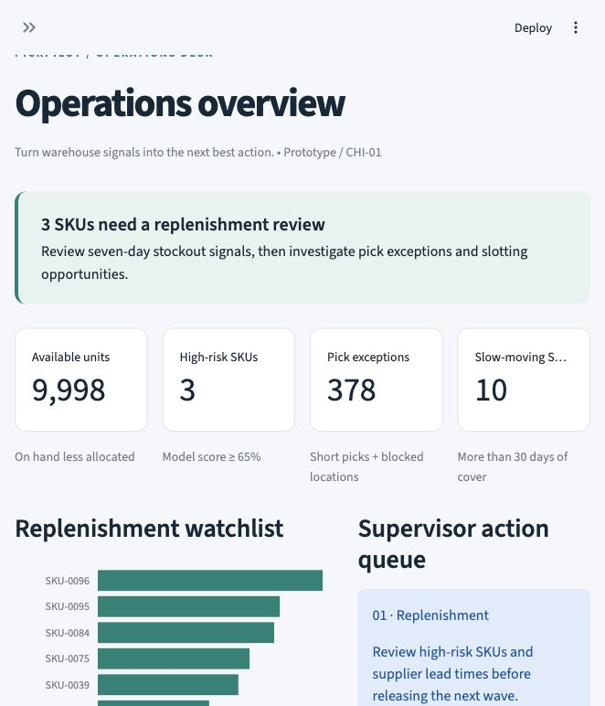
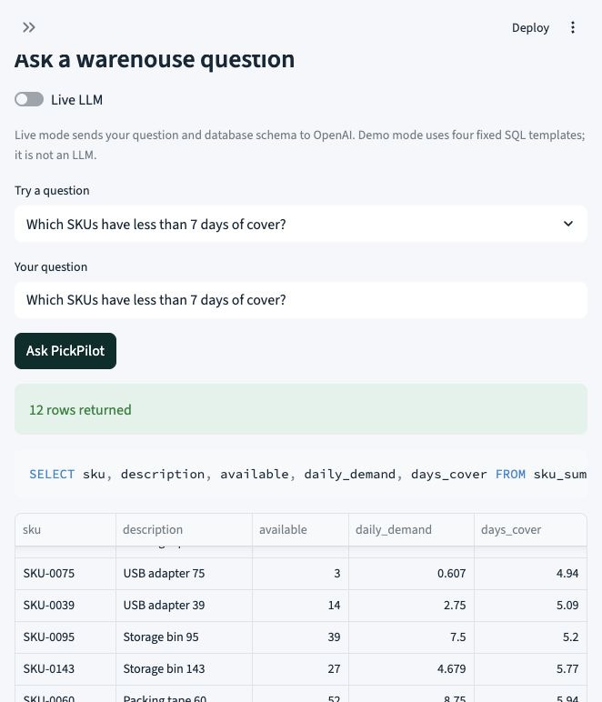
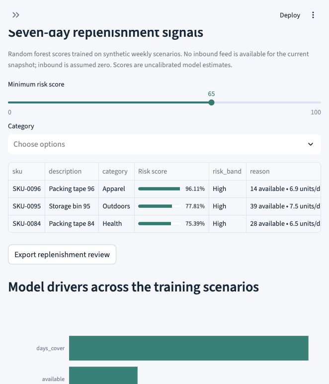
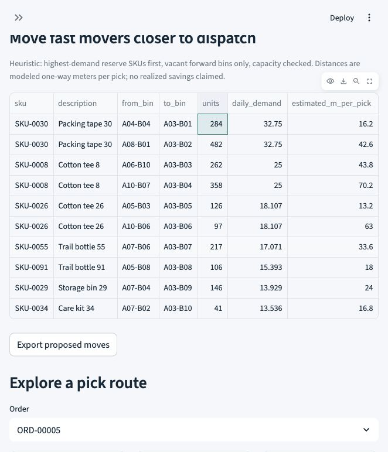
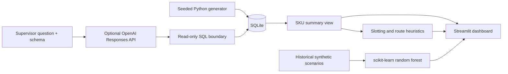

# ◈ PickPilot AI

A warehouse operations copilot prototype that turns fictional WMS data into inventory answers, seven-day stockout signals, and reviewable slotting and pick-route recommendations.

**[Launch the live demo](https://pickpilot-ai-vandana.streamlit.app/)** — free demo mode; no API key or sign-in required for inventory examples, risk scores, and slotting proposals.



**Status:** working prototype deployed on Streamlit Community Cloud, tested on synthetic data. No Oracle connection, warehouse user validation, or realized operational savings. Live LLM support is implemented but has not been exercised with a paid API key in this build.

## Run locally

Python 3.9–3.11 supported; Python 3.11 recommended.

```bash
python3 -m venv .venv
source .venv/bin/activate
pip install -r requirements.txt
python -m pickpilot.data
streamlit run app.py
```

Open the localhost URL shown by Streamlit. The app creates the deterministic database automatically if missing. `python -m pickpilot.data` replaces the local generated database; restart Streamlit after regenerating. Data stays local unless you enable Live LLM.

```bash
python -m pytest -q
```

The captured environment is recorded in `requirements-tested.txt`. Install that file to reproduce its exact package versions (Python 3.9 on macOS ARM).

## Tech stack

Python · Streamlit · SQLite/SQL · pandas/NumPy · scikit-learn · Plotly · optional OpenAI Responses API · pytest · GitHub Actions. No Oracle account is required.

## Three use cases

| Supervisor need | Prototype behavior | Evidence |
|---|---|---|
| Ask inventory questions | Live LLM translates questions to SQLite SQL; app executes read-only SQL, displays query, rows and a deterministic result summary | Four offline example queries + SQL boundary tests |
| Prioritize replenishment | Random forest returns a risk score and observed coverage per SKU | Temporal holdout and rule baseline |
| Improve picking workflows | Capacity-checked moves into vacant forward bins; nearest-neighbor route compared with bin-code order | Ten feasible slotting proposals; route distance cannot exceed comparison route |

### Inventory Q&A

Demo mode supports exactly four prewritten questions. It uses fixed SQL templates and is explicitly not an LLM. Free-form questions require Live LLM mode:

```bash
export OPENAI_API_KEY='your-key'
export OPENAI_MODEL='gpt-6-astra' # change to a Responses-compatible model available to your account
streamlit run app.py
```

Enable **Live LLM** in Ask inventory. Your question and allowlisted schema are sent to OpenAI using the [Responses API](https://developers.openai.com/api/docs/guides/text?lang=python), with `store=False`. Database rows are not sent. This storage flag does not replace the provider's applicable retention policy. Never commit keys. `.env.example` is a reference; the app reads exported environment variables, not `.env` automatically.

SQLite enforces a read-only connection and authorizer: operational tables/view only, no mutation, attach, pragmas, schema inspection, training-label reads, or extension/file functions. Queries are restricted to one statement, 200 result rows, and an approximately two-second VM execution budget. This is a local demo boundary, not a production multi-tenant sandbox. Only trusted users should access the prototype. The returned answer is derived directly from executed rows, rather than a second LLM call.



### Stockout scoring

`training_snapshots` contains 2,400 independent historical scenarios: 150 SKUs × 16 weekly cutoffs. Available stock, past 14-day demand estimate, lead time and inbound units are features. **Label:** a newly sampled future seven-day demand exceeds available units plus inbound that arrives within seven days. Future demand and label are excluded from model features.

Train on the first 12 cutoffs (1,800 rows), purge one weekly cutoff, test on the final three (450 rows). The same SKUs appear across periods; this measures future scenarios, not new-SKU generalization. The purge prevents adjacent seven-day label windows crossing train/test boundaries. All scenarios are simulated independently, not reconstructed from the operational event tables.

| Held-out metric | Result |
|---|---:|
| ROC AUC | 0.9361 |
| Average precision | 0.8945 |
| Precision at 0.50 | 0.8392 |
| Recall at 0.50 | 0.7692 |
| Brier score (lower better) | 0.0950 |
| Days-cover < 7 rule Brier | 0.1667 |
| Positive prevalence | 0.3467 |

These scores reflect learning a synthetic generator. They do not validate performance on real warehouse data. Scores are uncalibrated estimates; bands are Low <30%, Watch 30–65%, High ≥65%. Current demand uses requested units across 28 days; available stock subtracts allocations. The current snapshot assumes zero inbound because an inbound feed is absent. Full results: [model-validation.json](docs/model-validation.json).



### Slotting and routes

Slotting ranks fast movers in reserve, picks nearer vacant forward bins, checks capacity and uses each target once. A proposed move covers the listed source stock only. It does not simulate replenishment, ergonomic constraints, product compatibility or SKU consolidation. Estimated distance change is one-way meters per pick, not time or realized savings.

Routing visits both storage bins per SKU as a transparent illustration. It uses Manhattan distance from dispatch, a deterministic nearest-neighbor route with return to dispatch, and retains the baseline if the heuristic is worse. It is not an allocation or executable pick plan; stock feasibility, blocked bins, aisle direction, congestion, and travel restrictions require a WMS integration.



## Data and architecture

The primary six tables contain **exactly 10,000 rows**:

| Table | Rows | Grain |
|---|---:|---|
| items | 150 | SKU |
| locations | 100 | Bin |
| inventory | 300 | SKU × bin |
| orders | 1,200 | Order header |
| order_lines | 4,250 | Requested order line |
| picks | 4,000 | Pick task linked to order line |

Extra: `training_snapshots` (2,400 training scenarios) and `sku_summary` (aggregate view). Seed 42; snapshot 2026-11-04. Operational events span the prior 28 days. Not every order line has a pick task. Order header status is illustrative and not a reconciled fulfillment ledger. Demand is synthesized, as are stock and pick exceptions; do not interpret the data as a stock movement audit. Oracle WMS-style means familiar entities only, not a reproduction of Oracle's proprietary schema or APIs.



`pickpilot/data.py`: schema and generator · `risk.py`: temporal evaluation/scoring · `query.py`: live/demo translation and SQL execution boundary · `operations.py`: reviewable heuristics · `app.py`: UI. SQLite is the only implemented database; PostgreSQL is future scope.

## Demo and validation

[Open the screenshot demo](docs/demo.html) · [90-second narrated demo script](docs/DEMO.md) · [Validation details](docs/VALIDATION.md)

Run `python -m pytest -q` to validate row counts, foreign keys, example queries, SQL restrictions, query timeouts, model outputs and feasible moves/routes. GitHub Actions runs the same tests. No paid API call is required. The screenshot tour uses captures of the actual running Streamlit app, with no mocked UI. Open `docs/demo.html` locally to play the tour.

Before a real pilot: reconcile source feeds; use historical stock and inbound movements; validate labels with supervisors; measure Q&A accuracy on a warehouse question set; calibrate risk; compare against existing replenishment rules; incorporate route constraints; test access controls and obtain user feedback.

## Deploy a live demo

See [Streamlit deployment instructions](docs/DEPLOYMENT.md). Deploy `main` with `app.py` as the entry point and Python 3.11. The app generates its synthetic database on first launch; no database service is required.

## Portfolio language

Use this honest bullet for the current state:

> Built PickPilot AI, a warehouse operations prototype on 10,000 synthetic WMS-style records, with guarded inventory SQL querying, scikit-learn stockout-risk scoring, and slotting and pick-route recommendations; validated data integrity, query safeguards, and model behavior on synthetic scenarios.

After actually testing a live API key, you can add “LLM-powered inventory querying.” Claims of validated warehouse impact require a real pilot and measured outcomes.

## Repository

[github.com/vandanareddyn2920-hub/pickpilot-ai](https://github.com/vandanareddyn2920-hub/pickpilot-ai)

```bash
git clone https://github.com/vandanareddyn2920-hub/pickpilot-ai.git
cd pickpilot-ai
```

Generated SQLite files are excluded and recreated on first run. Source, tests, screenshots, a risk CSV, evaluation metrics, and the demo tour are included.
